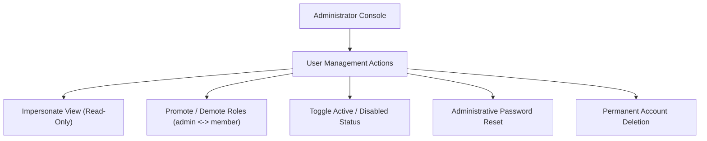

# Admin Console & Operations

Finly includes an administrative management suite accessible at `/admin` for users granted the `admin` role.

---

## System Overview & Health Metrics

The Overview tab provides real-time infrastructure and data volume metrics:

- **User Accounts**: Total registered users, active accounts, and administrative profiles.
- **Financial Volume**: Aggregated balance volume across all accounts and institutions.
- **Connection Counts**: Total connected banking endpoints and registered financial accounts.
- **Database Storage**: Exact size of `finly.db` on disk in megabytes.
- **Scheduler Liveness**: Status of the background APScheduler engine and active synchronization intervals.

---

## User Administration

Administrators can manage system users through a centralized data table:

### Impersonate User Session

To troubleshoot synchronization issues or verify categorization rules for another user, administrators can click **Voir dashboard** (View Dashboard):

- Generates an ephemeral JWT bearer token stamped with the target user's context and marked with `impersonated_by: <admin_id>`.
- Redirects immediately to the user's dashboard.
- The administrator can review the user's accounts, envelopes, and transactions without discovering their password.

---

## Maintenance & Diagnostic Suite

The Maintenance tab exposes system-level optimization actions:

### 1. Global Bank Synchronization Trigger
- **Endpoint**: `POST /api/v1/admin/maintenance/sync-all`
- **Function**: Queues a background task that initiates concurrent synchronization across all connected banking modules across all registered users.
- Useful after updating Woob modules or resolving network outages.

### 2. SQLite VACUUM Compaction
- **Endpoint**: `POST /api/v1/admin/maintenance/vacuum`
- **Function**: Executes `PRAGMA optimize;` followed by an autocommitted `VACUUM;` operation:
  - Reclaims disk space left by deleted transactions or purged accounts.
  - Defragments database B-tree pages.
  - Rebuilds table indexes for query execution speed.

### 3. Multi-Month Demo Data Seeding
- **Endpoint**: `POST /api/v1/admin/maintenance/seed-demo-data`
- **Function**: Generates a comprehensive, realistic 15-month historical financial dataset for testing, demos, or development.
  - Generates **403 realistic transactions** covering all 12 months of the current year plus preceding months.
  - Creates balanced cash flow: salary, rent, utilities, groceries, subscriptions, dining, and savings transfers.
  - Seeds PEA investment holdings (MSCI World ETF, Air Liquide, LVMH, Schneider Electric).
  - Creates a 20-year fixed-rate mortgage loan to showcase amortization schedule mathematics.
