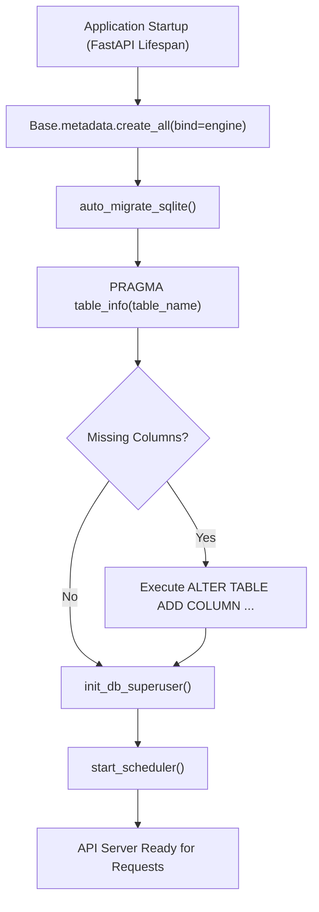

# Maintenance & Operations

This guide covers operational best practices, automated schema migrations, backup strategies, and process management for Finly in production.

---

## Automatic Database Schema Migrations

Finly uses an embedded auto-migration engine located in `backend/app/main.py`:



When upgrading Finly to a newer version:
1. `Base.metadata.create_all()` creates any newly introduced tables (such as `loans` or `investment_holdings`) if they do not yet exist.
2. `auto_migrate_sqlite()` inspects existing tables using SQLite PRAGMA commands and adds missing columns with default values (such as `custom_params`, `loan_type`, or `avatar_seed`).
3. Existing user credentials, bank connections, and transactions are preserved without data loss.

---

## Database Backup Strategies

Because Finly runs on a single SQLite file (`finly.db`), creating robust backups is straightforward:

### Method 1: SQLite Online Backup (Recommended)

When Finly is actively running in WAL mode, use the SQLite command-line tool to take an online snapshot without locking the database:

```bash
sqlite3 data/finly.db ".backup data/finly_backup_$(date +%Y%m%d_%H%M%S).db"
```

### Method 2: Checkpoint and File Copy

If copying the database file directly via automated scripts, flush the Write-Ahead Log (WAL) first:

```bash
# Flush WAL file into main finly.db
sqlite3 data/finly.db "PRAGMA wal_checkpoint(TRUNCATE);"

# Safely copy the file
cp data/finly.db /path/to/backup/storage/finly_$(date +%Y%m%d).db
```

### Automated Nightly Backup Cron Example

Add this entry to your server's `crontab`:

```cron
0 3 * * * sqlite3 /app/data/finly.db ".backup /backup/finly_$(date +\%Y\%m\%d).db"
```

---

## Process Supervision

### Running under Linux `systemd`

Create `/etc/systemd/system/finly.service`:

```ini
[Unit]
Description=Finly Financial Intelligence Backend
After=network.target

[Service]
Type=simple
User=finly
WorkingDirectory=/opt/finly/backend
ExecStart=/opt/finly/backend/venv/bin/uvicorn app.main:app --host 127.0.0.1 --port 8000
Restart=always
RestartSec=5
Environment=DATABASE_URL=sqlite:///./data/finly.db
Environment=SECRET_KEY=your_production_secret_key

[Install]
WantedBy=multi-user.target
```

Enable and start the service:

```bash
sudo systemctl daemon-reload
sudo systemctl enable --now finly
```
