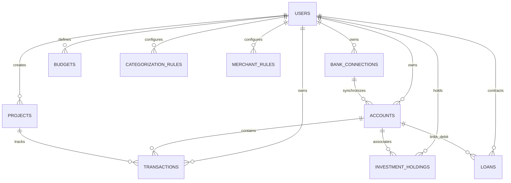

# Database & Data Models

Finly persists all financial and operational state in an SQLite database using SQLAlchemy declarative models.

---

## Entity-Relationship Diagram

---

## Core Table Specifications

### 1. `users`
Manages authenticated profiles, role-based access control, and user preferences.

| Column | Type | Constraints | Description |
| :--- | :--- | :--- | :--- |
| `id` | `VARCHAR` | Primary Key, Index | Unique identifier (e.g., `usr_...`). |
| `email` | `VARCHAR` | Unique, Index | User login email. |
| `full_name` | `VARCHAR` | Nullable | Profile display name. |
| `hashed_password` | `VARCHAR` | Not Null | Bcrypt hashed password. |
| `role` | `VARCHAR` | Default: `'member'` | Authorization level (`'admin'` or `'member'`). |
| `language` | `VARCHAR` | Default: `'en'` | Interface language code (`'fr'` or `'en'`). |
| `avatar_seed` | `VARCHAR` | Nullable | Seed for DiceBear Line-Face avatar generation. |
| `is_active` | `BOOLEAN` | Default: `True` | Account operational status. |
| `auto_sync_enabled`| `BOOLEAN` | Default: `False` | Enables scheduled background sync. |
| `sync_interval_hours`| `INTEGER` | Default: `12` | Frequency of background bank sync (6, 12, 24). |
| `sync_time` | `VARCHAR` | Default: `'08:00'` | Scheduled reference time. |

---

### 2. `bank_connections`
Stores configuration for open-banking Woob modules.

| Column | Type | Constraints | Description |
| :--- | :--- | :--- | :--- |
| `id` | `VARCHAR` | Primary Key, Index | Unique connection identifier (`conn_...`). |
| `user_id` | `VARCHAR` | Foreign Key, Index | Owning user ID. |
| `module_name` | `VARCHAR` | Not Null | Woob module identifier (e.g., `bourso`, `caissedepargne`). |
| `bank_name` | `VARCHAR` | Not Null | User-facing institution name. |
| `login` | `VARCHAR` | Not Null | Banking login identifier. |
| `password` | `VARCHAR` | Nullable | Encrypted credential string. |
| `backend_name` | `VARCHAR` | Unique, Index | Name of local Woob storage backend. |
| `status` | `VARCHAR` | Default: `'connected'` | Status (`'connected'`, `'action_needed'`, `'error'`). |
| `custom_params` | `TEXT` | Nullable | JSON string storing module configuration and regional bank parameters. |
| `last_synced_at` | `DATETIME` | Nullable | Timestamp of last successful sync. |

---

### 3. `accounts`
Represents physical financial accounts synchronized from banks or created manually.

| Column | Type | Constraints | Description |
| :--- | :--- | :--- | :--- |
| `id` | `VARCHAR` | Primary Key, Index | Account ID (`acc_...`). |
| `user_id` | `VARCHAR` | Foreign Key, Index | Owning user ID. |
| `backend_name` | `VARCHAR` | Index | Linked Woob backend name. |
| `bank_account_id` | `VARCHAR` | Index | Bank-assigned account number or IBAN. |
| `name` | `VARCHAR` | Not Null | Account label (e.g., "Compte Courant", "Livret A"). |
| `iban` | `VARCHAR` | Nullable | International Bank Account Number. |
| `account_type` | `VARCHAR` | Not Null | Classification (`Checking`, `Savings`, `PEA`, `Brokerage`). |
| `balance` | `FLOAT` | Default: `0.0` | Current settled balance. |
| `currency` | `VARCHAR` | Default: `'EUR'` | ISO-4217 currency code. |
| `color` | `VARCHAR` | Default styling | Tailwind CSS gradient class for visual card rendering. |

---

### 4. `transactions`
Historical financial ledger records.

| Column | Type | Constraints | Description |
| :--- | :--- | :--- | :--- |
| `id` | `VARCHAR` | Primary Key, Index | Transaction ID (`tx_...`). |
| `user_id` | `VARCHAR` | Foreign Key, Index | Owning user ID. |
| `account_id` | `VARCHAR` | Foreign Key, Index | Source account ID. |
| `bank_tx_id` | `VARCHAR` | Index | Unique bank identifier for reconciliation. |
| `booking_date` | `VARCHAR` | Index | Date of operation settling (`YYYY-MM-DD`). |
| `value_date` | `VARCHAR` | Index | Value date (`YYYY-MM-DD`). |
| `booking_datetime`| `DATETIME` | Nullable | Exact transaction timestamp. |
| `amount` | `FLOAT` | Not Null | Signed amount (+ for income, - for expense). |
| `raw_label` | `VARCHAR` | Not Null | Original bank statement label. |
| `merchant_name` | `VARCHAR` | Nullable, Index | Cleaned commercial entity name. |
| `category` | `VARCHAR` | Index | Main expense/revenue category. |
| `subcategory` | `VARCHAR` | Nullable | Detailed subcategory classification. |
| `is_user_classified`| `BOOLEAN` | Default: `False` | Locks classification from automated re-categorization. |
| `is_excluded_from_budget`| `BOOLEAN` | Default: `False` | Excludes internal transfers and loans from budget envelopes. |
| `project_id` | `VARCHAR` | Nullable | Linked goal or investment project ID. |
| `tags` | `TEXT` | Nullable | Comma-separated custom tags. |

---

### 5. `loans`
Mortgages, auto loans, and debt obligations tracked with amortization mathematics.

| Column | Type | Constraints | Description |
| :--- | :--- | :--- | :--- |
| `id` | `VARCHAR` | Primary Key, Index | Loan identifier (`loan_...`). |
| `user_id` | `VARCHAR` | Foreign Key, Index | Owning user ID. |
| `name` | `VARCHAR` | Not Null | Description (e.g., "Crédit Immobilier RP"). |
| `loan_type` | `VARCHAR` | Default: `'mortgage'` | Type (`mortgage`, `auto`, `consumer`, `student`, `other`). |
| `lender_name` | `VARCHAR` | Nullable | Lending bank or credit organization. |
| `principal_amount`| `FLOAT` | Not Null | Total borrowed capital. |
| `interest_rate` | `FLOAT` | Not Null | Annual fixed interest rate in percent (e.g., `3.10`). |
| `insurance_rate` | `FLOAT` | Default: `0.30` | Annual borrower insurance rate in percent. |
| `duration_months`| `INTEGER` | Not Null | Total loan term in months (e.g., `240` for 20 years). |
| `start_date` | `VARCHAR` | Not Null | Repayment start date (`YYYY-MM-DD`). |
| `monthly_payment`| `FLOAT` | Nullable | Total monthly installment (computed or overridden). |
| `linked_account_id`| `VARCHAR` | Nullable | Account debited for monthly installments. |

---

### 6. `investment_holdings`
Stock portfolio and equities holdings.

| Column | Type | Constraints | Description |
| :--- | :--- | :--- | :--- |
| `id` | `VARCHAR` | Primary Key, Index | Position identifier (`hold_...`). |
| `user_id` | `VARCHAR` | Foreign Key, Index | Owning user ID. |
| `account_id` | `VARCHAR` | Nullable | Associated brokerage or PEA account ID. |
| `symbol` | `VARCHAR` | Not Null, Index | Ticker symbol (e.g., `CW8`, `MC.PA`, `AAPL`). |
| `name` | `VARCHAR` | Not Null | Asset name. |
| `asset_type` | `VARCHAR` | Default: `'stock'` | Asset class (`stock`, `etf`, `crypto`, `fund`). |
| `quantity` | `FLOAT` | Default: `0.0` | Number of held shares. |
| `buy_price` | `FLOAT` | Default: `0.0` | Weighted average purchase price (PRU). |
| `current_price` | `FLOAT` | Default: `0.0` | Latest settlement price. |
| `sector` | `VARCHAR` | Nullable | Economic sector for portfolio allocation. |
