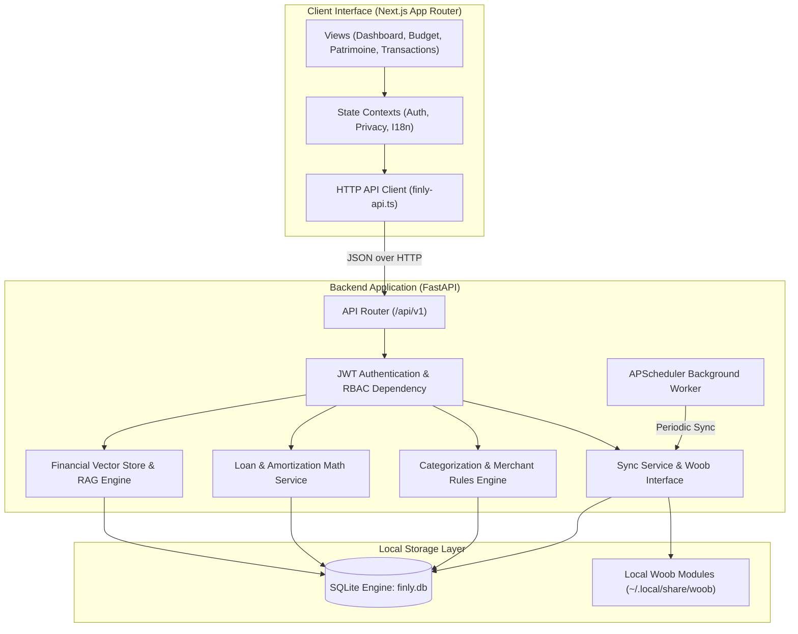

# System Architecture

Finly uses a modular, decoupled architecture where a Python FastAPI backend serves high-performance REST APIs to a modern Next.js client interface.

---

## High-Level Component Topology

---

## Presentation Layer (Frontend)

The frontend is built using **Next.js 16**, **React 19**, **Tailwind CSS**, and **Shadcn UI**:

- **App Router Architecture**: Utilizes route groups `(dashboard)` for authenticated application views and isolated authentication pages (`/login`).
- **Dark Mode OLED Palette**: Exclusively styled around a Zinc-950 (`#09090B`) OLED background with surface cards on Zinc-900 (`#18181B`) and border accents using `border-white/10`.
- **Global Privacy Blur**: Implements an instantaneous privacy masking layer (`usePrivacy()`) that blurs amounts and balances across all views with a single keyboard shortcut or header toggle.
- **Bilingual Internationalization**: Dynamic client-side language switching between French (`fr`) and English (`en`) without page reloads.

---

## Application & Services Layer (Backend)

The backend is built with **FastAPI** and **Python 3.11**:

- **Asynchronous & Synchronous Coexistence**: Async endpoints handle concurrent client requests while blocking Woob scraping operations run in isolated background threads to prevent event loop starvation.
- **Service-Oriented Design**: Business logic is decoupled from HTTP handlers into dedicated services:
  - `sync_service.py`: Orchestrates multi-bank synchronization, challenge handling, and transaction reconciliation.
  - `loan_service.py`: Handles loan amortization calculations, payment split computations, and early repayment simulations.
  - `llm_provider_service.py` & `financial_vector_store.py`: Ingests financial contexts, maintains in-memory vector embeddings, and communicates with LLM providers.
- **Background Cron Engine**: Built-in APScheduler manages automated background bank synchronization according to user preferences (every 6, 12, or 24 hours).

---

## Persistence & Concurrency

- **Engine**: SQLite 3 with SQLAlchemy 2.0 ORM.
- **WAL Mode (Write-Ahead Logging)**: Configured with `PRAGMA journal_mode=WAL;` to allow multiple concurrent readers while background sync threads write new records.
- **Automatic Migration Engine**: The `auto_migrate_sqlite()` lifecycle hook verifies missing tables and columns on every application startup, applying schema migrations automatically.
