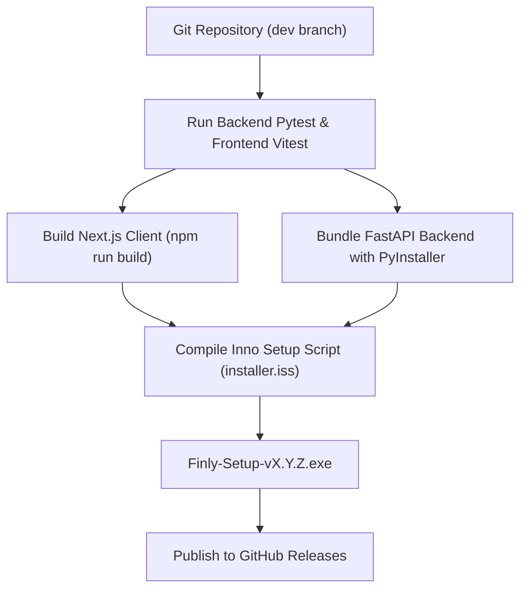

# Packaging & Releases

This guide details the release engineering pipeline used to compile, bundle, and package Finly into standalone executables and desktop installers.

---

## Release Pipeline Overview



---

## 1. Backend Compilation (PyInstaller)

The Python backend is packaged into a self-contained Windows executable (`finly_backend.exe`) using **PyInstaller**:

```bash
cd backend
pyinstaller --noconfirm --onedir --windowed \
    --name "finly_backend" \
    --add-data "app;app" \
    --hidden-import "uvicorn" \
    --hidden-import "sqlite3" \
    --hidden-import "woob" \
    app/main.py
```

- Packages Python 3.11 runtime, dependencies, and native C-extensions.
- Eliminates the requirement for end users to have Python or Pip installed on their systems.

---

## 2. Frontend Production Export

The Next.js frontend is built in standalone mode:

```bash
cd finly-app
npm run build
```

- Generates pre-rendered static HTML routes and optimized JavaScript chunks.
- Ensures zero TypeScript compilation errors across all views and modals.

---

## 3. Windows Setup Compilation (Inno Setup)

The release installer is authored in `installer.iss` and compiled using **Inno Setup 6**:

### Key Features of `installer.iss`:

1. **Non-Destructive Database Upgrades**:
   - The installer checks if `%LocalAppData%\Programs\Finly\data\finly.db` already exists.
   - If present, existing databases, user credentials, and historical transactions are untouched.
2. **Optional Ollama Bundling**:
   - Allows users to opt into downloading and installing local Ollama inference capabilities during installation.
   - Displays clear hardware requirement disclaimers.
3. **Desktop & Start Menu Integration**:
   - Creates clean application shortcuts pointing to the main launcher executable.
   - Automatically handles process clean-up upon uninstallation.

### Compiling the Installer

From a Windows shell with Inno Setup installed:

```bash
"C:\Program Files (x86)\Inno Setup 6\ISCC.exe" installer.iss
```

The resulting artifact is created in the `Output/` folder: `Finly-Setup-v1.0.26.exe`.

---

## 4. Release Checklist

Before tagging a new production release:

1. [ ] Ensure all backend tests pass: `pytest` in `backend/`.
2. [ ] Ensure all frontend tests pass: `npm test` in `finly-app/`.
3. [ ] Run Next.js production build: `npm run build` in `finly-app/`.
4. [ ] Verify version number synchronization in `backend/app/core/config.py`, `package.json`, and `installer.iss`.
5. [ ] Ensure documentation is up to date in `docs/`.
6. [ ] Tag git commit with semantic version: `git tag vX.Y.Z`.
7. [ ] Publish installer binary and changelog to GitHub Releases.
