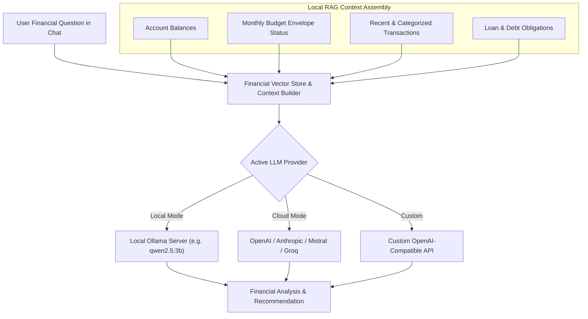

# AI Financial Assistant

Finly includes an embedded conversational financial assistant capable of analyzing spending habits, identifying budget leaks, projecting savings trajectories, and answering ad-hoc queries regarding transactions.

---

## Multi-Provider Architecture

The assistant supports a multi-provider backend design that balances complete local privacy against cloud model capabilities:

---

## Supported Providers

| Provider | Model Recommendations | Privacy Characteristics | Performance Characteristics |
| :--- | :--- | :--- | :--- |
| **Local Ollama** | `qwen2.5:3b`, `mistral:7b`, `llama3.2` | 100% private, executed locally on device CPU/GPU. No internet required. | Depends on local CPU/RAM/VRAM hardware. |
| **OpenAI** | `gpt-4o-mini`, `gpt-4o` | Requires user API key. Transmits prompt context over HTTPS to OpenAI. | Fast and highly capable reasoning. |
| **Anthropic** | `claude-3-5-sonnet`, `claude-3-haiku` | Requires user API key. Transmits prompt context over HTTPS to Anthropic. | Superior nuance and financial reasoning. |
| **Mistral AI** | `mistral-small-latest`, `codestral` | Requires user API key. European sovereign cloud hosting. | Excellent bilingual French/English accuracy. |
| **Groq** | `llama-3.1-70b-versatile` | Requires user API key. High-speed LPU inference. | Near-instantaneous response times (< 1 second). |

---

## Local Hardware Disclaimer

When utilizing local Ollama models:

> **Hardware Consideration**: Local language model performance directly correlates with your computer's hardware specifications (CPU thread count, unified RAM, and dedicated GPU VRAM). Lightweight models (`qwen2.5:3b` or `llama3.2:3b`) are recommended for laptops and standard desktops without dedicated GPUs. Heavier models (`mistral:7b`, `llama3.1:8b`) provide richer answers but require at least 8 GB of free system memory or a dedicated NVIDIA RTX / Apple Silicon GPU.

---

## Financial Vector Store & RAG Pipeline

Finly avoids external cloud vector databases by utilizing an **in-memory vector store**:

1. **Context Indexing**: When an inquiry is submitted, relevant account balances, category totals, loan schedules, and recent transactions are indexed locally.
2. **Context Window Assembly**: Data is synthesized into a concise, deterministic system prompt using strict financial prompt engineering templates.
3. **Guardrails**: The prompt instructs the model to adhere strictly to observed data, avoid hallucinating speculative returns, and decline investment advice that violates legal boundaries.
4. **Zero Persistent Storage**: Context vectors are evaluated in memory and discarded upon conversation completion.
