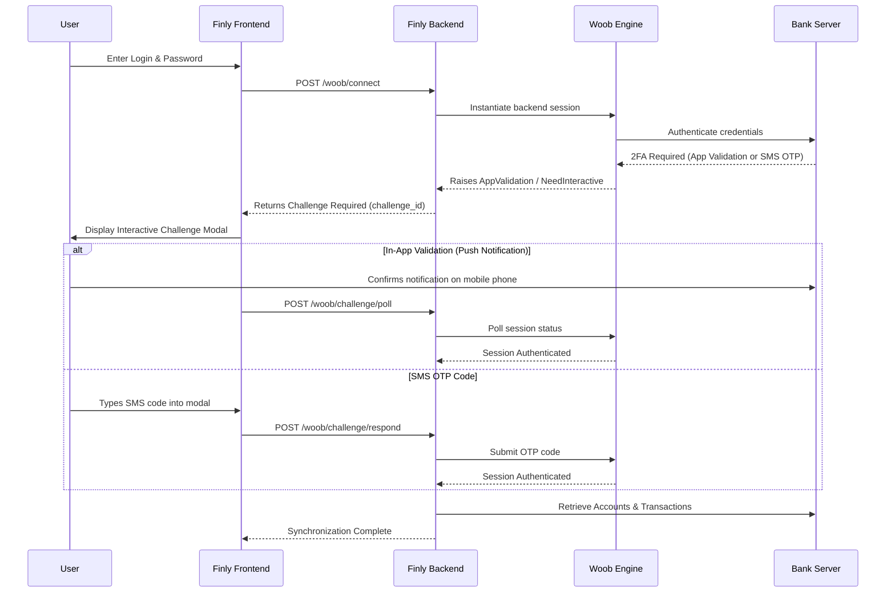

# Bank Synchronization & 2FA

Finly connects directly to commercial and cooperative banks using **Woob** (Web Outside of Browsers), an open-source Python library for interacting with financial services.

---

## Direct Banking Architecture

Traditional personal finance aggregators require you to transmit credentials to intermediary SaaS brokers. Finly executes the synchronization locally on your machine:

```
[Finly App] ---> [Local Python Backend] ---> [Direct Bank TLS API / Web Portal]
```

All authentication cookies, TLS handshakes, and account balance queries originate from your computer's IP address.

---

## Supported Institutions

Finly supports major French and European banking institutions, including:

- **BoursoBank** (`bourso`)
- **Fortuneo** (`fortuneo`)
- **BNP Paribas** (`bnporange`)
- **Société Générale** (`societegenerale`)
- **Crédit Agricole** (`creditagricole` with regional caisses)
- **Caisse d'Épargne** (`caissedepargne` with regional caisses)
- **Banque Populaire** (`banquepopulaire`)
- **LCL** (`lcl`)
- **La Banque Postale** (`labanquepostale`)
- **Revolut** (`revolut`)
- **Crédit Mutuel / CIC** (`creditmutuel`)

### Regional Bank Selectors

For institutions operating as regional cooperatives (such as Caisse d'Épargne or Crédit Agricole), Finly provides regional selector dropdowns during setup. Selected regional identifiers are stored in the connection's `custom_params` and passed to the Woob backend configuration.

---

## Interactive 2FA / SCA Challenge Handling

Modern banks require Strong Customer Authentication (SCA) under PSD2 regulations. Finly handles interactive 2FA challenges through a synchronized state machine:



### Challenge Lifecycle API Endpoints

- `POST /api/v1/woob/connect`: Starts connection attempt. Returns connection status or challenge descriptor.
- `POST /api/v1/woob/challenge/respond`: Submits user response (e.g., OTP token) to active challenge.
- `POST /api/v1/woob/challenge/poll`: Checks pending state for mobile app push approvals.
- `DELETE /api/v1/woob/challenge/{challenge_id}`: Aborts pending challenge session.

---

## Transaction Reconciliation Engine

When retrieving operations, Finly prevents duplicate entries while preserving user modifications:

1. **Identifier Matching**: Looks up existing transactions using `bank_tx_id`.
2. **Composite Fallback Matching**: If the bank omits stable identifiers, matches against `booking_date` + `amount` + `raw_label` + `account_id`.
3. **Preservation of User Overrides**: If an existing transaction has `is_user_classified = True`, automatic categorization will never overwrite the user's manual category, subcategory, or budget exclusion flag.
4. **Account Balance Synchronization**: Updates current account balances from the bank's live reported balance.

---

## Background Scheduled Synchronization

Finly includes an integrated scheduler powered by **APScheduler**:

- Configured per-user in account settings (`/compte`).
- Selectable intervals: **Every 6 Hours**, **Every 12 Hours**, or **Every 24 Hours**.
- Executes headless synchronization in background worker threads without disrupting active user interactions.
