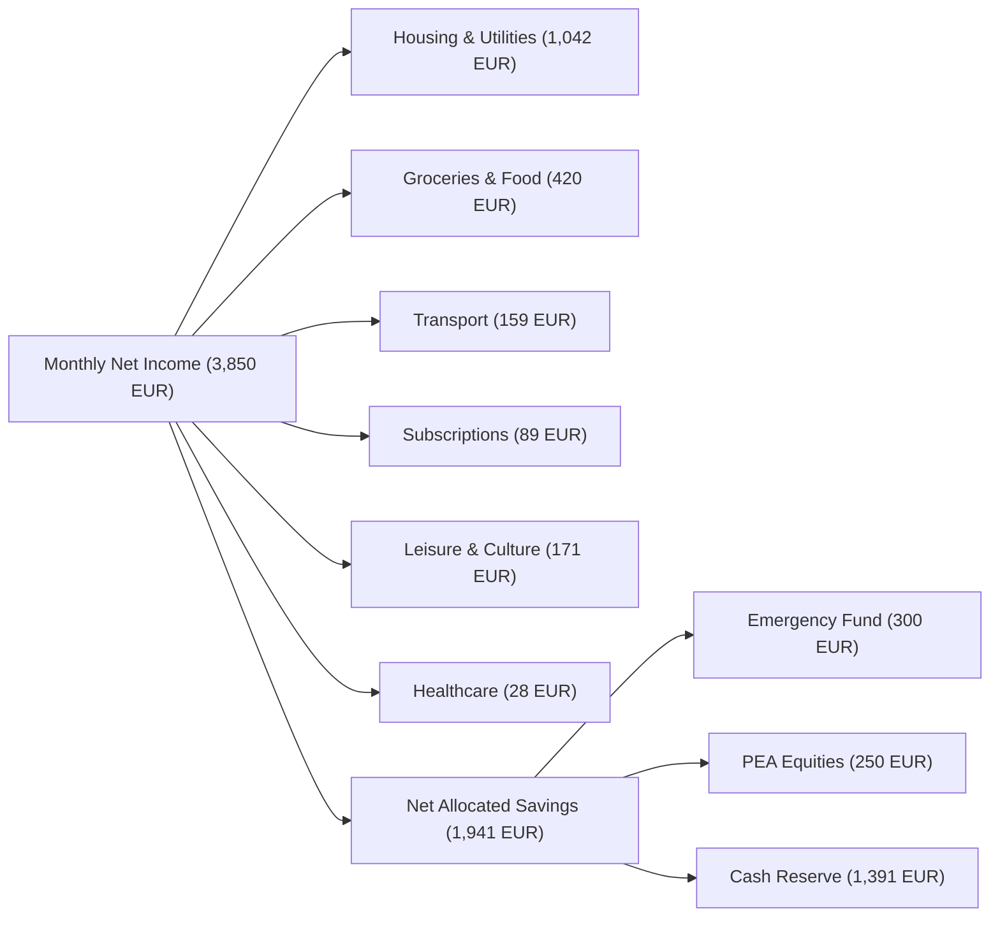

# Budgeting & Cash Flow

Finly implements an envelope budgeting system that monitors monthly burn rates across spending categories while isolating consumable expenses from savings deposits.

---

## Envelope Budgeting System

Each expense category can be assigned a target monthly spending limit (envelope). Finly continuously computes:

$$\text{Remaining Budget} = \text{Monthly Limit} - \sum \text{Eligible Expenses}$$

$$\text{Consumption Rate} = \frac{\sum \text{Eligible Expenses}}{\text{Monthly Limit}} \times 100\%$$

### Visual Progress Indicators

Envelopes provide immediate visual feedback based on consumption rate:

- **Green (< 80%)**: Normal spending pace.
- **Amber (80% - 100%)**: Nearing threshold warning.
- **Rose / Red (> 100%)**: Budget exceeded with amount over limit highlighted.

---

## Deposit Account Filtering

A frequent flaw in multi-bank budget software is the accidental contamination of spending metrics by savings accounts (e.g., transfers from Checking to Livret A showing up as expenses, or savings balance drawdowns showing up as revenue).

Finly strictly enforces **deposit account filtering**:

1. Only **Checking & Demand Deposit** accounts (`Compte Courant`, `checking`, `deposit`) are included in monthly budget calculations.
2. Savings accounts (`Livret A`, `LDDS`, `LEP`), investment portfolios (`PEA`, `Assurance Vie`), and crypto wallets are strictly excluded from budget totals.
3. Users can switch from all checking accounts across banks to a single specific checking account using the account selector dropdown.

---

## Sankey Cash Flow Diagrams

Finly renders interactive **Sankey diagrams** to illustrate how monthly income distributes across expenses, taxes, and savings allocations:

---

## Month-by-Month Historical Navigation

Finly supports continuous calendar navigation:

- **Calendar Month Selector**: Select and analyze any specific month (e.g., `2026-10`, `2026-05`, `2025-11`).
- **Trailing 30-Day View**: Toggle to dynamic real-time rolling 30-day analytics.
- **Previous / Next Month Controls**: Quickly page backward or forward in history to review seasonal expense patterns.

---

## PDF Budget Reports

Users can generate client-side PDF budget summaries using the **Export PDF** action:

- Formatted for print or offline archiving using `jsPDF`.
- Summarizes category limits, actual consumption, percentage ratios, and cash flow balance.
- Completely generated within the browser without uploading financial data to an external PDF generation server.
