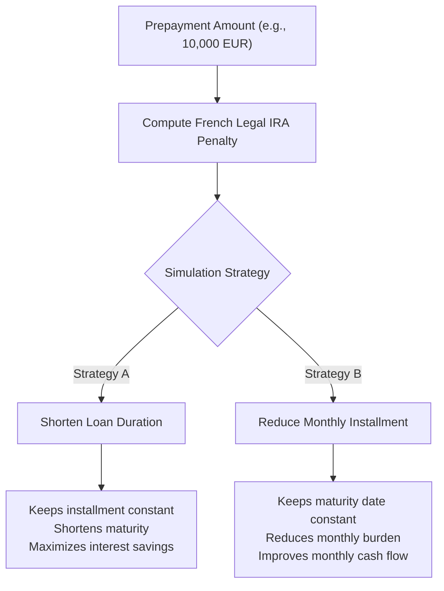

# Loans & Amortization

Finly features a comprehensive debt and mortgage management engine with exact French amortization schedule mathematics, status tracking, and early repayment simulation.

---

## Mathematical Formulation

Amortizing loans in Finly utilize the standard **French fixed-rate annuity formula** (constant total monthly installments with increasing principal and decreasing interest components):

### 1. Monthly Annuity Installment ($M$)

$$M = P \times \frac{r(1 + r)^n}{(1 + r)^n - 1}$$

Where:

- $P$ = Initial borrowed principal capital
- $r$ = Periodic monthly interest rate: $r = \frac{\text{Annual Interest Rate}}{100 \times 12}$
- $n$ = Total loan duration in months ($\text{duration\_months}$)

### 2. Borrower Insurance Installment ($I_{\text{ins}}$)

For standard French loans where insurance is computed on the initial borrowed capital:

$$I_{\text{ins}} = P \times \frac{\text{Annual Insurance Rate}}{100 \times 12}$$

### 3. Total Monthly Payment ($M_{\text{total}}$)

$$M_{\text{total}} = M + I_{\text{ins}}$$

---

## Month-by-Month Amortization Schedule

For each payment period $k$ from $1$ to $n$:

1. **Periodic Interest Component**:
   $$\text{Interest}_k = \text{Remaining Principal}_{k-1} \times r$$

2. **Principal Amortization Component**:
   $$\text{Principal}_k = M - \text{Interest}_k$$

3. **Remaining Capital**:
   $$\text{Remaining Principal}_k = \text{Remaining Principal}_{k-1} - \text{Principal}_k$$

---

## Live Status Computation

The engine calculates real-time metrics based on the loan's `start_date` and the current date:

- **Elapsed Payments ($k$)**: Number of monthly installments settled to date.
- **Remaining Payments ($n - k$)**: Months remaining until full loan maturity.
- **Amortized Capital**: Cumulative sum of principal repaid.
- **Outstanding Capital**: Current balance contributing to liability deductions in personal net worth.
- **Repayment Progress**: $\frac{\text{Amortized Capital}}{P} \times 100\%$.

---

## Early Repayment Simulator

Finly provides an early repayment calculator allowing users to simulate lump-sum prepayments (e.g., 5,000 EUR or 20,000 EUR):

### French Legal IRA Penalty Cap (Indemnité de Remboursement Anticipé)

Under Article L313-47 of the French Consumer Code, early repayment penalties for residential property loans cannot exceed:

$$\text{IRA} = \min\left(\text{Repayment Amount} \times 3\%,\; \text{Repayment Amount} \times \frac{\text{Annual Interest Rate}}{100} \times \frac{6}{12}\right)$$

Finly automatically applies this legal cap when computing simulated net interest savings.
