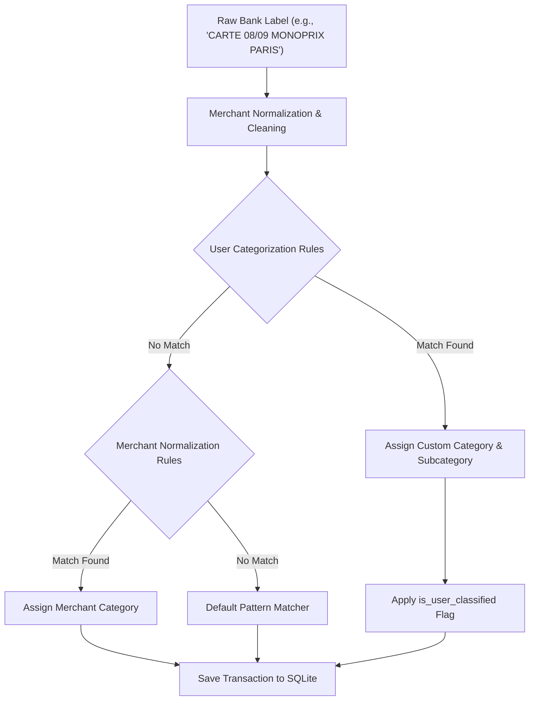

# Categorization Engine & Rules

Finly features a deterministic rules engine that cleans raw banking labels, matches merchant entities, and assigns hierarchical categories and subcategories.

---

## Transaction Ingestion Pipeline

---

## Rule Types & Match Operators

Users can create automated categorization rules in the **Dépenses** or **Transactions** views. Rules support three matching operators:

| Operator | Syntax / Example | Use Case |
| :--- | :--- | :--- |
| `contains` | `MONOPRIX` | Matches any label substring, case-insensitive. |
| `exact` | `PRLV SEPA EDF CLIENT PARTICULIER` | Matches the full string verbatim. |
| `regex` | `^CARTE \d{2}/\d{2} UBER.*` | Complex pattern matching with regular expressions. |

### Field Target Scope

Rules can evaluate specific target fields:

- `raw_label`: Evaluates the unmodified string provided by the banking institution.
- `merchant_name`: Evaluates the cleaned commercial entity name.
- `all` / `both`: Evaluates both attributes, triggering if either matches.

### Amount Thresholds

Rules can conditionally match on transaction amounts:

- Any amount (default)
- Only expenses (`amount < 0`)
- Only income (`amount > 0`)
- Absolute threshold filtering (e.g., transactions greater than 500 EUR)

---

## Precedence & Execution Order

When a new transaction is processed, the rules engine executes in strict hierarchy:

1. **User Custom Rules (`categorization_rules`)**: Evaluated in order of user priority. First matching rule wins.
2. **Merchant Entity Rules (`merchant_rules`)**: Matches recognizable commercial brands (e.g., "Carrefour", "Netflix", "EDF") and automatically applies standardized logos and default classifications.
3. **Internal Transfer Detection**: Transfers matching internal account names or patterns like `VIR SEPA ... VERS LIVRET A` are automatically categorized as `Épargne` / `Virement interne` and marked with `is_excluded_from_budget = True`.
4. **Keyword Fallback Heuristics**: Fallback pattern matching for common expenses (e.g., bakery, supermarket, pharmacy, rail transport).

---

## Exclusion from Budget Envelopes

Not every transaction should affect your monthly spending budget. Transactions can be excluded from budget envelope consumption:

- **Internal Savings Transfers**: Transferring 300 EUR from Checking to Savings is a liquidity reallocation, not a consumable expense.
- **Investment Contributions**: Moving funds into a PEA or brokerage account.
- **Health Reimbursements**: CPAM or mutual insurance credits offsetting previous medical bills.
- **Debt Principal Amortization**: If loan repayments are tracked separately in the Loans module.

Excluded transactions display a discreet crossed-out indicator and are excluded from budget limit totals.
