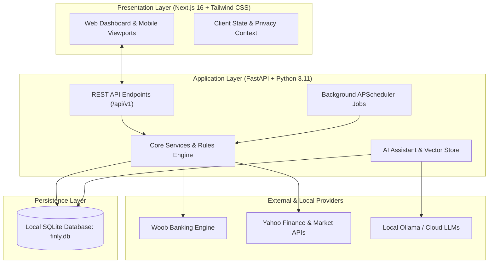

# Finly Documentation

Welcome to the technical documentation for **Finly**, a self-hosted, local-first personal wealth and finance intelligence platform.

Finly provides bank synchronization without intermediaries, private asset and debt tracking, multi-envelope budgeting, dynamic transaction categorization, and an optional local or cloud AI assistant.

---

## Key Principles

- **Local-First & Privacy by Design**: All transaction data, credentials, and investment histories remain on your physical machine in an SQLite database. Zero telemetry or external SaaS dependencies are required.
- **Direct Banking Connectivity**: Interacts directly with banking APIs and scraping endpoints via the open-source Woob protocol without routing sensitive login credentials through third-party data brokers.
- **Zero-Compromise Security**: Banking tokens are stored locally using AES-256 Fernet cryptography. The client interface features instant privacy blur modes and scoped role-based access control.
- **Open Standards & Interoperability**: Direct access to raw SQLite data, bidirectional CSV parsing, encrypted JSON backups, and built-in Model Context Protocol (MCP) server endpoints for AI agent pair programming.

---

## Architectural Blueprint

---

## Documentation Structure

| Section | Focus Areas |
| :--- | :--- |
| **Getting Started** | System prerequisites, installation modes (Windows executable, Docker Compose, manual developer environment), and configuration variables. |
| **Architecture** | System layout, relational database models, SQLite optimizations, security model, and credential encryption. |
| **Core Features** | Direct bank synchronization, transaction categorization rules engine, budgeting envelopes, wealth & loan tracking, and the AI assistant. |
| **Integrations** | Model Context Protocol (MCP) server, CSV imports, encrypted JSON backups, and report generation. |
| **Administration** | System metrics, database vacuum maintenance, user impersonation, and multi-month historical demo seeding. |
| **Development** | Backend FastAPI development, Next.js frontend patterns, test suites, and Inno Setup release packaging. |

---

## Quick Navigation

- [Overview & Philosophy](getting-started/overview.md)
- [Installation Guide](getting-started/installation.md)
- [Bank Synchronization Engine](features/bank-synchronization.md)
- [Loans & Amortization Module](features/loans-and-amortization.md)
- [AI Financial Assistant](features/assistant-and-ai.md)
- [Model Context Protocol (MCP)](integrations/mcp-server.md)
